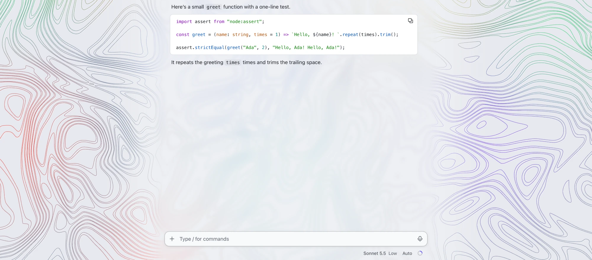
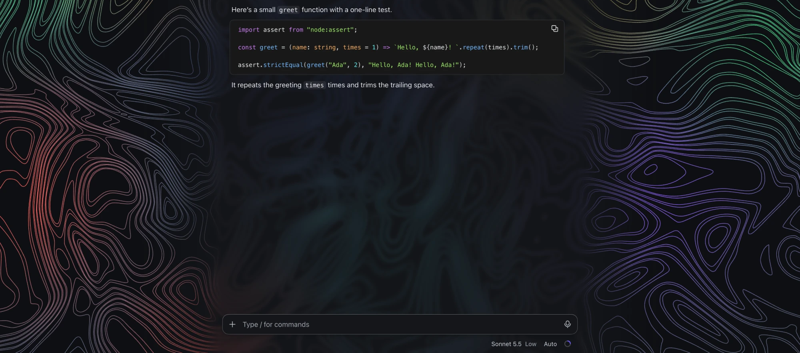

# Holo Damascus

A theme for Claude: a pearl-white page covered in fine Damascus contour lines that carry a slow prismatic sheen. In dark mode the same lines become glowing foil on near-black.





It themes the Claude desktop and mobile apps (colours, code highlighting accents and an animated backdrop). The terminal draws no theme, so nothing changes there.

**Needs Claude Code v2.1.324 or later.** Check the version in the desktop app's Code tab before installing.

## Install

In the Claude desktop app: click **+** next to the prompt box, then **Plugins**, **Add marketplace** with `bassonrichard/holo-damascus`, then **Add plugin**.

Or, at the prompt of a Claude Code terminal session:

```
/plugin install holo-damascus --marketplace bassonrichard/holo-damascus
```

Answer `y` to add the marketplace, then press Enter to install for your user. Or from a shell:

```bash
claude plugin install holo-damascus --marketplace bassonrichard/holo-damascus
```

Start a new session and the theme paints. It follows the app's light or dark mode.

## Update

When a new version is out, run these two commands, then start a new session:

```bash
claude plugin marketplace update holo-damascus
```

```bash
claude plugin update holo-damascus@holo-damascus
```

## If the theme doesn't show up

- **Start a new session.** A session keeps the look it started with, so one that was already open won't change.
- **Turn off other themes.** Only one theme can stand per session. With two enabled you get one theme's colours with the other's backdrop, or the wrong one entirely. Disable the other in **+** → **Plugins**.
- **Update Claude.** Themes need Claude Code v2.1.324 or later. Older versions install the plugin and paint nothing.
- **Stuck in dark mode?** That is another theme winning. Holo Damascus follows the app's light or dark setting; some themes are dark-only.

## Good to know

- Only one theme can stand per session. If you have another theme mod enabled, turn it off, or the two will fight over the look.
- The sheen drifts on a 90 second loop and stops when your system asks for reduced motion.
- To remove it: `claude plugin uninstall holo-damascus`.

## Make it yours

The line pattern is generated, not drawn by hand. For a different swirl, run the generator with any number as the seed:

```bash
node tools/gen.js 42
```

It rewrites `hooks/scene.ts`. The knobs at the top of `tools/gen.js` set line spacing, the gap inside each pair of lines, feature size and how hard the pattern folds. Colours are in `hooks/register.tsx`, and `glass.opacity` there sets how much of the pattern shows through panels.

## Licence

MIT. The files `hooks/make-colors.js` and `hooks/make-colors.d.ts` come from Claude Code's plugin authoring kit.
